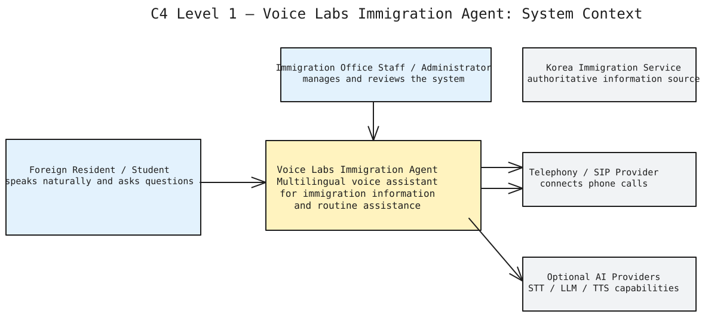
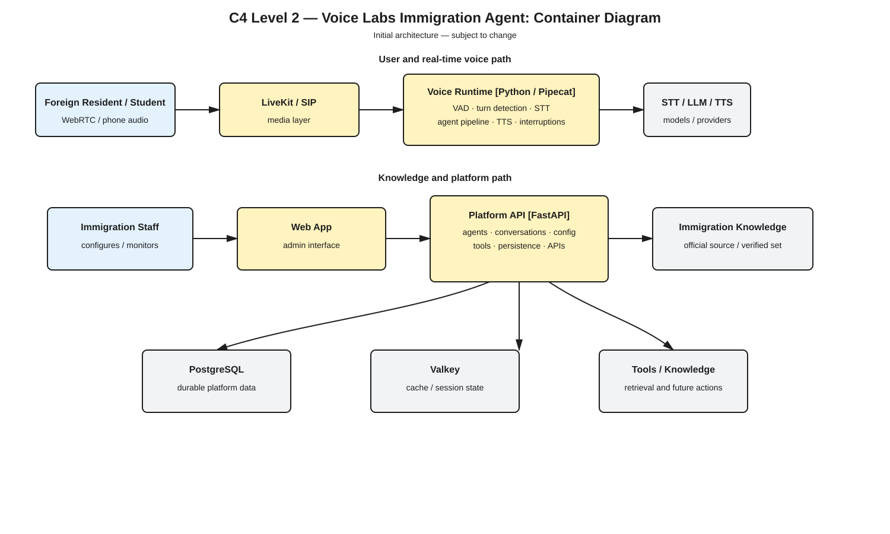

# Voice Labs

Voice Labs is our platform for building real-time multilingual Voice AI agents.

The goal is to build one reliable voice platform that can understand natural conversations across multiple languages — including people switching languages in the same conversation or sentence — and then adapt that platform to different use cases such as support, sales, booking, transportation, restaurants, healthcare, and call centers.

Instead of building a different voice system for every industry, we keep the core runtime reusable and customize each agent with its own instructions, tools, knowledge, integrations, and voice.

## How it works

```text
Speech In
    ↓
VAD / Turn Detection
    ↓
Speech-to-Text
    ↓
Agent / LLM
    ↓
Tools & Integrations
    ↓
Text-to-Speech
    ↓
Speech Out
```

Our first focus is getting the hard part right: **multilingual speech, code-switching, natural turn-taking, interruptions, and low latency**.

Initial language testing focuses on English, Russian, and English/Russian code-switching.
Korean and other languages are deferred until the first vertical slice is measured.

## Stack

We reuse proven tools where they make sense and keep our own platform logic independent from individual providers.

Our initial stack includes:

* **FastAPI** — platform APIs and backend services
* **Pipecat** — real-time voice pipeline and orchestration
* **LiveKit** — WebRTC, real-time media, and SIP
* **Silero VAD** — voice activity detection
* **Smart Turn** — conversational turn detection
* **PostgreSQL** — primary database
* **Valkey** — cache and temporary session state
* **OpenTelemetry** — tracing and instrumentation
* **Prometheus + Grafana** — metrics and monitoring
* **Docker / Docker Compose** — local development and deployment

For STT, TTS, and LLMs we keep provider interfaces open. Current self-hosted candidates include **Qwen3-ASR**, **Chatterbox Multilingual**, and **Qwen models served through vLLM**, but these will be selected based on our own multilingual and latency benchmarks.

## Workspace

`stack.voice-labs` owns shared local infrastructure, environment configuration, and the
documentation site. Application code is staged in two sibling repositories; the six
source repositories remain untouched as recoverable copies. No remotes or submodules are
configured yet.

```text
capst/
├── stack.voice-labs/      # shared Compose, env example, docs, acceptance tests
├── backend.voice-labs/    # platform/, runtime/, evals/ (local staging repository)
├── frontend.voice-labs/   # Next.js application (local staging repository)
├── platform.voice-labs/   # unchanged source copy
├── runtime.voice-labs/    # unchanged source copy
├── web.voice-labs/        # unchanged source copy
├── evals.voice-labs/      # unchanged source copy
├── docs.voice-labs/       # unchanged source copy
└── infra.voice-labs/      # unchanged source copy
```

`backend.voice-labs` groups Platform, Runtime, and Evals under one uv workspace while
retaining their project-level conventions. `frontend.voice-labs` owns the web client.
Actual remotes and submodule mounts are deferred until manual publication and review.

## Getting Started

### Requirements

Make sure you have:

```text
Git
Docker
Docker Compose
Python 3.11+
Node.js and npm
```

### Clone

Clone the workspace. Submodules are intentionally added only after the independent
repositories have been published and reviewed:

```bash
git clone git@github.com:<organization>/stack.voice-labs.git
cd stack.voice-labs
```

Cloning this repository alone does not fetch application code. The current
`backend.voice-labs` and `frontend.voice-labs` sibling staging repositories have no
remotes yet; after they are manually published, clone them alongside `stack.voice-labs`
before using the app startup commands below.

Create the shared local environment file:

```bash
cp .env.example .env
```

Start the local infrastructure (PostgreSQL, Valkey, and LiveKit):

```bash
docker compose up -d
```

The Compose file starts infrastructure only; the Platform API, Runtime API, and web
application run from their sibling repositories. The root `.env` is the shared local
configuration for all three apps. When starting an app from its repository directory,
export that file into the process environment with the commands below; this avoids copying
provider credentials and shared tokens between repositories. Keep `PLATFORM_RUNTIME_TOKEN`
and `RUNTIME_PLATFORM_TOKEN` identical. The LiveKit development server uses `devkey` /
`secret`; these are local-only credentials. If you override `POSTGRES_PORT` or
`LIVEKIT_PORT`, also update the host ports in `PLATFORM_DATABASE_URL` or `LIVEKIT_URL`
respectively; Compose does not rewrite application URLs.

Start the Platform API from `backend.voice-labs/platform` after PostgreSQL is healthy.
The `../../stack.voice-labs/.env` path assumes the sibling repository layout shown above:

```bash
uv sync --extra test
set -a
source ../../stack.voice-labs/.env
set +a
uv run python -m alembic upgrade head
uv run uvicorn src.platform.main:app --reload --port 8000
```

Start the Runtime API from `backend.voice-labs/runtime` in another terminal:

```bash
uv sync --extra voice --extra test
set -a
source ../../stack.voice-labs/.env
set +a
uv run uvicorn src.runtime.api:app --reload --port 8001
```

Start the web app from `frontend.voice-labs` in a third terminal, exporting the same shared
settings so Next.js receives `NEXT_PUBLIC_PLATFORM_URL`:

```bash
npm ci
set -a
source ../stack.voice-labs/.env
set +a
npm run dev
```

These commands do not require per-app `.env` copies. If an app-specific `.env` or the
web app's `.env.local` is used instead, keep its values synchronized with the shared file.

Build the documentation site from this repository with `zensical build --strict` after
installing dependencies from `requirements.txt`.

The browser-to-agent voice path also requires valid `DEEPGRAM_API_KEY`,
`OPENAI_API_KEY`, `CARTESIA_API_KEY`, and `CARTESIA_VOICE_ID` values. Placeholder values
do not provide speech recognition or synthesis; the Runtime should report provider
configuration/connectivity failures rather than a successful voice session.

### Real-provider acceptance

The deterministic cross-service tests stub STT, LLM, and TTS. To exercise real providers,
first start the local stack and export its `.env` as above. Supply a 1–60 second,
uncompressed 16-bit PCM WAV speech recording (mono or stereo, 16–96 kHz) and the words
spoken in it (at least four words), then opt in explicitly. For example, `ffmpeg` can
convert a recording to the accepted format:

```bash
ffmpeg -i speech-input.m4a -vn -ac 1 -ar 48000 -c:a pcm_s16le /tmp/voice-acceptance.wav
```

Then run:

```bash
export VOICE_ACCEPTANCE_REAL_PROVIDERS=1
export VOICE_ACCEPTANCE_AUDIO_FILE=/absolute/path/to/speech.wav
export VOICE_ACCEPTANCE_EXPECTED_TRANSCRIPT='the words spoken in the recording'
python -m pytest -q tests/test_real_voice_acceptance.py
```

This test sends real audio through LiveKit and the configured STT, LLM, and TTS providers;
it checks transcript matching, a constrained assistant response, received speech audio,
persisted lifecycle state, and disconnect handling. It may incur provider charges. It skips
unless explicitly opted in; with opt-in enabled, incomplete configuration fails before any
provider request. It uses an isolated in-memory SQLite database by default; if setting
`PLATFORM_ACCEPTANCE_DATABASE_URL`, use a disposable database because acceptance records
are retained for inspection.

To update the workspace later:

```bash
git pull
```

## Development Approach

Keep things simple and build around real requirements.

We prefer proven open-source tools over rebuilding solved infrastructure, but Voice Labs itself remains our platform. STT, TTS, LLM, telephony, and other providers should stay replaceable, and we avoid adding microservices or infrastructure until there is a real reason for them.

The priority is clean code, clear ownership, low latency, measurable performance, and an architecture that can grow without forcing us to rewrite the core system.

## Project Documentation

### C4 Level 1 — System Context

<a href="./docs/architecture/c4.level.svg"></a>

### C4 Level 2 — Container Diagram

<a href="./docs/architecture/c4-container.svg"></a>

- [Data Sources](docs/DATA_SOURCES.md)
- [Test Plan](docs/TEST_PLAN.md)
- [Backend Architecture](docs/BACKEND_ARCHITECTURE.md)
- [Backend Tasks](docs/BACKEND_TASKS.md)
- [Backend MVP Definition of Done](docs/BACKEND_MVP.md)

## Team

Authors, GitHub handles, and role ownership are tracked in [`AUTHORS.yml`](AUTHORS.yml).

| Name | GitHub | Responsibilities |
|------|--------|------------------|
| Abdilazhanov Bekbolot | [@abdibekbolot](https://github.com/abdibekbolot) | AI / engineering, models and workflow |
| Aiymzhan Doskempirova | [@aimzhandos67](https://github.com/aimzhandos67) | Data research, presentation and demo video |
| Dayan Dayerbekova | [@avokebryad-svg](https://github.com/avokebryad-svg) | Team representative, value proposition |
| Milana Baibalaeva | [@milana2811](https://github.com/milana2811) | Project submissions and deadlines, minute taker |
| Bekali | [@qrtman](https://github.com/qrtman) | AI / engineering, data research |
| Aidar | [@Raidnk](https://github.com/Raidnk) | AI / engineering |
