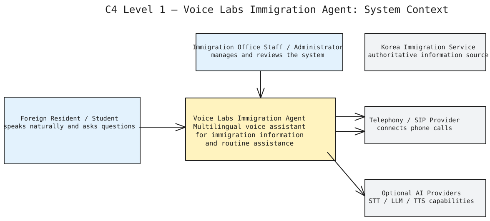
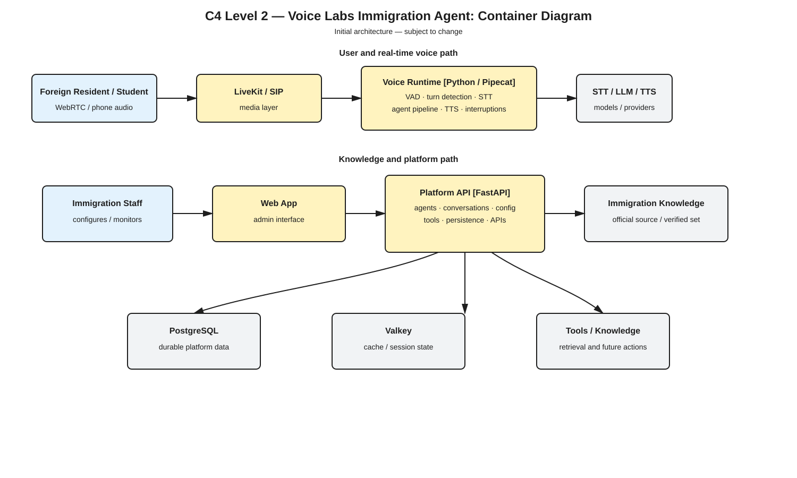

# Voice Labs

Voice Labs is a platform for **real-time, multilingual voice AI agents**: a caller talks, by
voice, to an agent that has a prompt, tools and knowledge, and the agent answers out loud.

**The current goal** is an AI voice agent people can actually call. What that means, where it
stands and the next proofs are on one page: [Goal](https://github.com/N2-Voice-Labs/backend.voice-labs/blob/main/docs/goal.md). What works and with what
evidence: [Status](https://github.com/N2-Voice-Labs/backend.voice-labs/blob/main/docs/status.md).

The same Runtime can also translate a two-person call (shareable link) and run an agent that
translates for its caller. Those exist in the code but are not the current goal.

## How a call works

```text
Browser mic
   │  WebRTC
   ▼
LiveKit  ◄──── Platform issues a short-lived room token
   │
   ▼
Runtime (Pipecat pipeline)
   Silero VAD + Smart Turn  →  Deepgram STT  →  OpenAI LLM  →  Cartesia TTS
   │                                                              │
   │ audio back through LiveKit to the browser  ◄─────────────────┘
   │
   └─ lifecycle and transcript events (HTTP/JSON, authenticated)
         ▼
      Platform  →  PostgreSQL (conversations, messages, session state)
```

- **Platform** (FastAPI) is the control plane and durable source of truth. It never touches audio.
- **Runtime** owns the live session: LiveKit, the Pipecat pipeline, VAD, turn detection, and
  barge-in (interruptions).
- Runtime reports events to Platform. Platform stores each event once (idempotent by event ID).

See [Concepts](concepts.md) for the object model and [Contracts](https://github.com/N2-Voice-Labs/backend.voice-labs/blob/main/docs/contracts.md) for API details.

## The three repositories

| Repository | Owns |
| --- | --- |
| `stack.voice-labs` (this repo) | Docker Compose (PostgreSQL, Valkey, LiveKit), shared `.env`, this docs site, cross-service acceptance tests |
| `backend.voice-labs` | `platform/` (control-plane API), `runtime/` (live voice pipeline), `evals/` (evaluation tooling) in one uv workspace |
| `frontend` | The Next.js web app (landing page, agent workspace, Voice Playground, call pages), deployed to Cloudflare Workers |

Compose starts infrastructure only. Platform, Runtime, and the web app run from their own repositories.

## Start here

| Page | Use it to |
| --- | --- |
| [Goal](https://github.com/N2-Voice-Labs/backend.voice-labs/blob/main/docs/goal.md) | What we are building now and what comes next |
| [System overview](SYSTEM_OVERVIEW.md) | Everything we have: features, architecture, open-source stack |
| [Run locally (team guide)](run-locally.md) | **Start here:** run the whole stack on your machine and talk to an agent |
| [Quickstart: API tour](quickstart-api.md) | Take a 5-minute API tour, no provider keys needed |
| [Quickstart: voice](quickstart-voice.md) | Talk to an agent with real speech |
| [Concepts](concepts.md) | Learn the Voice, Agent, Deployment, and Conversation model |
| [Development](development.md) | Run tests and work on the code |
| [Troubleshooting](troubleshooting.md) | Fix common setup and runtime problems |
| [Contracts](https://github.com/N2-Voice-Labs/backend.voice-labs/blob/main/docs/contracts.md) | Look up endpoints, events, and error codes |

## Architecture diagrams

<a href="architecture/c4.level.svg"></a>

<a href="architecture/c4-container.svg"></a>

## Current status

See [Status](https://github.com/N2-Voice-Labs/backend.voice-labs/blob/main/docs/status.md) in the backend repository. It uses three evidence levels
(implemented, mock-tested, real-provider-verified) and is the only status page; this site does not
copy it. The billable real-provider checklist is the [Smoke test](https://github.com/N2-Voice-Labs/backend.voice-labs/blob/main/docs/smoke-test.md).
